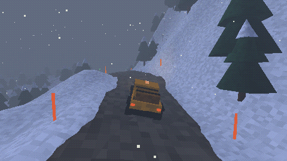
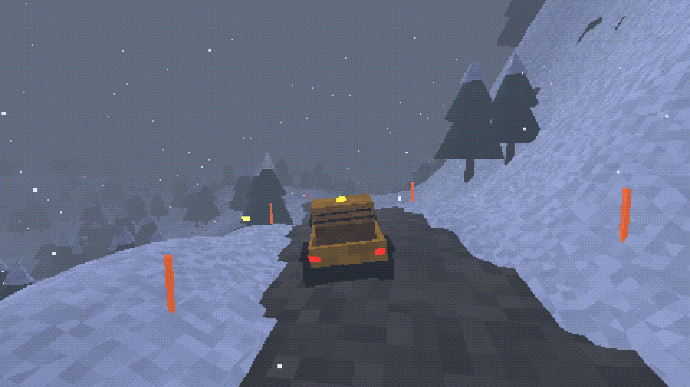
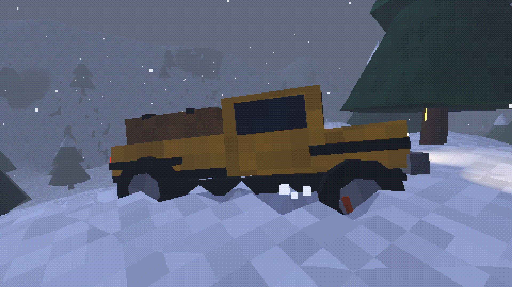
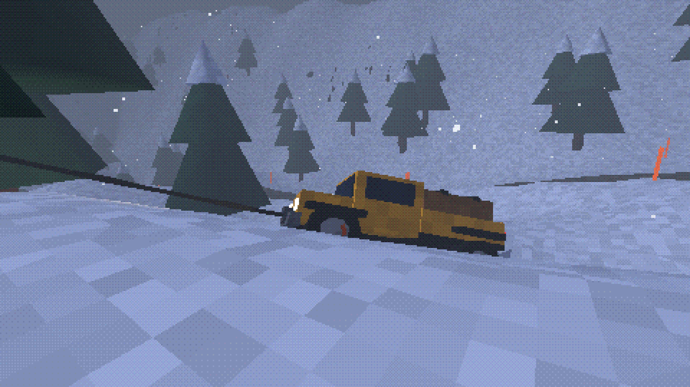
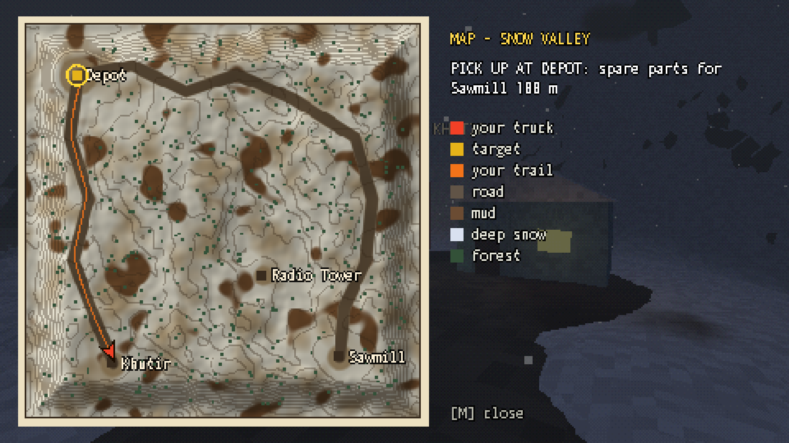

# Khutir Road



A small orange 4x4, a snowbound valley at dusk, and cargo that has to get through. Khutir Road is
a PSX-style off-road delivery game: haul groceries to a lone *khutir* (a Ukrainian farmstead),
spare parts to the sawmill and drone batteries to the radio tower, through deep snow and mud
that pack down into ruts under your wheels.

Godot 4.7.2 (GL Compatibility, Jolt Physics), everything procedural; runs on Windows, Linux,
macOS and in the browser.

Trailer: https://youtu.be/HrOh6fI9AkE ([media/trailer/khutir-road-trailer.mp4](media/trailer/khutir-road-trailer.mp4)) ·
itch.io: https://codirs.itch.io/psxrunner

| | |
|---|---|
|  |  |
|  |  |

## Controls

| Key | |
|---|---|
| W / S | throttle / brake, reverse |
| A / D | steer |
| Space | handbrake |
| Q | all-wheel drive (4x4) |
| X | differential lock |
| G | low range |
| H | headlights |
| E | load / unload / refuel (stopped, at a depot or a delivery point) |
| F | winch to the tree or rock ahead; hold Shift to reel in |
| M | paper map |
| T | tow back to the depot ($100) |
| R | flip upright |
| Right mouse + drag, wheel | orbit and zoom the camera |
| F1 | the help: a short hint in the corner, then every key, then none |

Keys are physical, so they sit in the same place on any keyboard layout.

## Run from source

```bash
./godot.sh run                    # downloads Godot 4.7.2 into tools/godot/ the first time
./godot.sh run -- --autodrive     # the truck drives the east road by itself
GODOT=/path/to/Godot_v4.7.2-stable_win64_console.exe ./godot.sh run   # use a Godot you have
./godot.sh editor
```

## Tests

```bash
./godot.sh check        # every script parses, every shader compiles
./godot.sh test         # tests/test_*.gd against one shared world, at a fixed 60 fps
./godot.sh soundcheck   # record the game's mix on a scripted drive into capture/soundcheck.wav
```

The tests build the real valley and drive it: the truck stands on four wheels, drives the road,
burns fuel and leaves ruts; snow and mud grip less and drag more until packed down; the delivery
loop pays; the winch pulls; the engine revs through its gears and labours when the truck can't
move, the tyres crunch and squelch only when they roll; and no text in the game or on screen is
left untranslated. Any error the engine logs during a test fails it, and a watchdog ends a run
that hangs. The soundcheck prints how loud each part of its drive was.

## Export

```bash
./godot.sh export          # Web, Windows, Linux and macOS into builds/ (fetches the export templates once, ~600 MB)
./godot.sh export Web      # or Windows | Linux | macOS
./godot.sh web             # export Web and serve it on http://localhost:8060
```

macOS: a universal `.app` in a zip, ad-hoc signed, not notarized: open it the first time with
right-click > Open. Web: single-threaded (no SharedArrayBuffer), so it runs on itch.io without
COOP/COEP headers.

## Release to itch.io

Every push to `main` runs `.github/workflows/godot.yml`: the tests, then all four exports (the
Web build is kept as a 3-day artifact). A `vX.Y.Z` tag also creates a GitHub Release, and each
export is pushed by butler to its channel of https://codirs.itch.io/psxrunner (`html5`,
`windows`, `linux`, `mac`), with the Windows, Linux and macOS files attached to the release.

Needs the `BUTLER_API_KEY` repository secret (an itch.io API key: https://itch.io/user/settings/api-keys);
the `ITCH_TARGET` repository variable overrides `codirs/psxrunner`. The version is the top entry
of [CHANGELOG.md](CHANGELOG.md) = `config/version` in `project.godot` = the tag. The
`release-itch` skill (`.claude/skills/`) walks the whole procedure. On the first release, mark the
`html5` upload on itch.io as "played in the browser" (viewport 960x540; it scales).

## Store media

```bash
./godot.sh capture             # scripts/capture/director.gd drives and films the trailer scenes into capture/trailer/
python tools/make_media.py     # the trailer, screenshots, cover and GIF into media/
```

The director runs the game at a fixed frame rate, so every capture is the same. `make_media.py`
needs Python 3 with Pillow and NumPy, and Blender 4.5 for the MP4 (its FFmpeg is the encoder).
Copy for the itch.io page is in [media/itch-page.md](media/itch-page.md).

## Sound

```bash
python tools/make_sounds.py    # cut sounds/source/ (CC0 recordings, never shipped) into sounds/
```

Needs Python 3 with NumPy, SciPy and soundfile. [docs/sound.md](docs/sound.md) has the
recordings, the cuts, how the truck plays them and how loud.

## Credits

Font: [Inconsolata](https://github.com/googlefonts/Inconsolata) by Raph Levien and the Inconsolata
Project Authors, SIL Open Font License 1.1 ([fonts/OFL.txt](fonts/OFL.txt)).

Sounds: CC0 recordings by Joseph SARDIN of [BigSoundBank](https://bigsoundbank.com) (a diesel
truck engine, footsteps in snow, an electric winch) and by rubberduck
([25 CC0 mud sfx](https://opengameart.org/content/25-cc0-mud-sfx), OpenGameArt).
